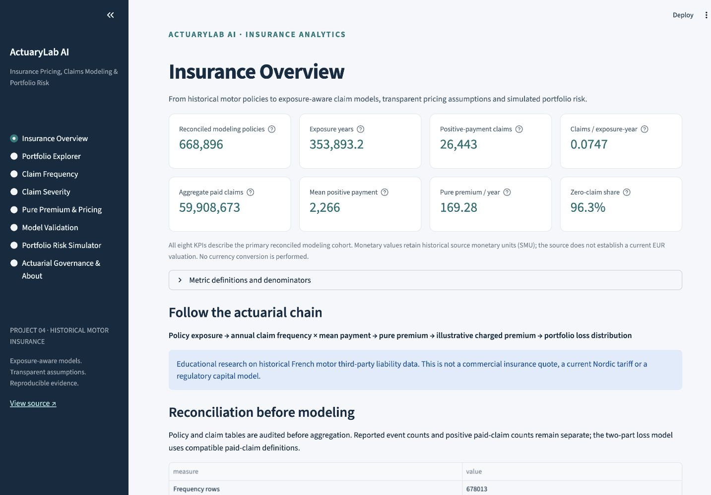
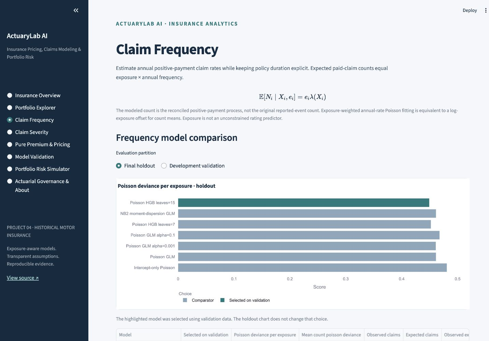
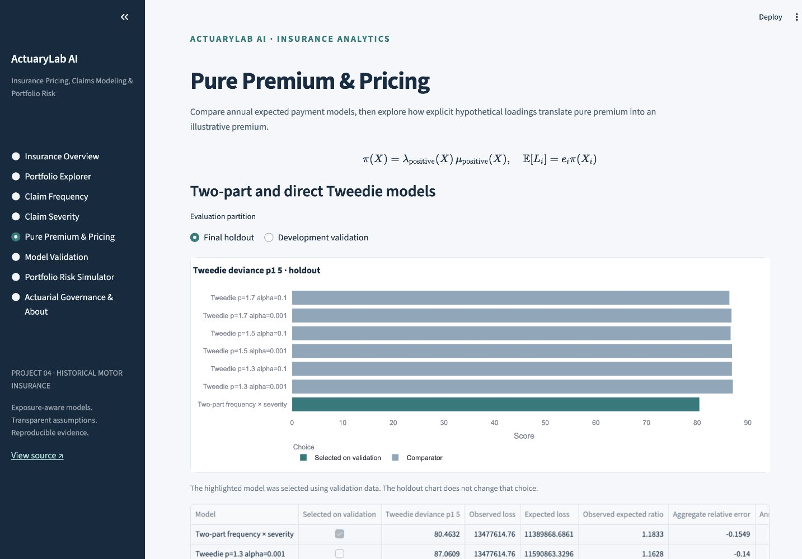
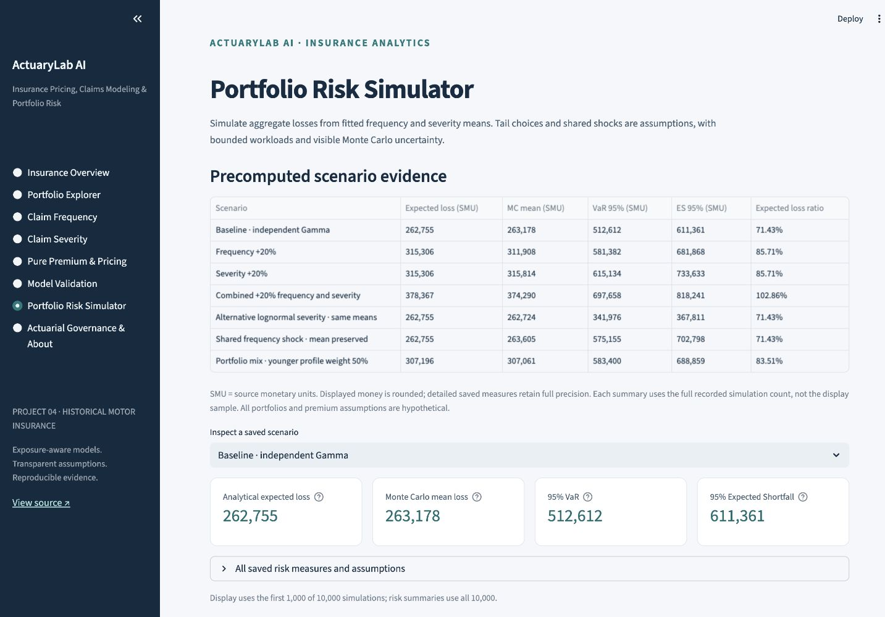

# ActuaryLab AI

### Insurance Pricing, Claims Modeling & Portfolio Risk Platform

An educational insurance data science project by **Priynka Roy**. ActuaryLab AI investigates how exposure-aware claim frequency, positive-payment severity and direct pure-premium models compare on historical French motor third-party liability data, then explores hypothetical pricing and aggregate portfolio risk.

[Delivery report](docs/DELIVERY_REPORT.md) · [Methodology](docs/METHODOLOGY.md) · [Data card](docs/DATA_CARD.md) · [Model card](docs/MODEL_CARD.md) · [Portfolio case study](docs/PORTFOLIO_CASE_STUDY.md) · [Deployment](docs/DEPLOYMENT.md)

This is a professional portfolio project, not a production pricing engine, insurance offer, reserving model, regulatory capital model or approved tariff. No insurer sponsors or endorses it. The project does not claim current Finnish portfolio representativeness or professional actuarial certification.

## Insurance problem and data

A policy with a fraction of a year of coverage cannot be compared with a full-year policy by raw claim count alone. Expected payment also depends on the frequency and size of claims; a useful mean prediction does not automatically describe large-loss tail risk. This project keeps those quantities separate and validates each with a suitable actuarial scoring rule.

The real source files are [OpenML freMTPL2freq 41214](https://www.openml.org/d/41214) and [freMTPL2sev 41215](https://www.openml.org/d/41215), both version 1. Attribution: C. Dutang and A. Charpentier (2018), *CASdatasets: Insurance datasets*. The upstream [CASdatasets documentation](https://github.com/dutangc/CASdatasets/blob/master/man/freMTPL.Rd) describes an unnamed historical French insurer, approximately 2011–2013, with some IRSA-IDA convention payments.

OpenML metadata declares these versions **CC0**; the upstream CASdatasets R package separately declares **GPL (>= 2)**. The project does not redistribute raw records. Original code and documentation are MIT licensed. See the [license and provenance review](docs/DATA_CARD.md) for the distinction and source links. Amounts are **source monetary units (SMU)**; no currency conversion or inflation adjustment is silently applied.

## Reconciliation changes the modeling population

| Quantity | Measured result |
|---|---:|
| Original frequency policies | 678,013 |
| Upstream narrative policy count | 677,991 |
| Original severity rows | 26,639 |
| Unmatched payment rows | 195 |
| Exact repeated payment rows retained | 255 |
| Policies with inconsistent claim counts | 9,117 |
| Primary economic-cohort policies | 668,896 |
| Primary exposure-years | 353,893.168 |
| Primary positive payments | 26,443 |
| Primary aggregate recorded payment | 59,908,673.17 SMU |

The original frequency table declares 36,102 claims; the matched primary process contains 26,443 positive payments. There are 9,116 policies declaring a claim with no available severity record. Unknown payments are not filled with economic zero. The strict cohort excludes unresolved count/payment histories, and this can change population composition. Claims are aggregated once per policy before a validated one-to-one join. Repeated equal payments remain because no unique claim identifier establishes whether they are accidental duplicates. No payment clipping, count clipping or exposure capping is used. [Full audit and rules](docs/DATA_RECONCILIATION.md).

## Methods and evaluation

- **Frequency:** intercept benchmark, Poisson log GLM, regularized Poisson alternatives and Poisson histogram gradient boosting. Annual count/exposure response uses exposure weights, equivalent to an unpenalized count model with fixed log-exposure offset. A negative-binomial development diagnostic investigates material overdispersion.
- **Severity:** intercept and Gamma log GLMs on individual strictly positive payments. Claim rows inherit the parent policy split. A training-only large-payment cap refit is a sensitivity diagnostic; primary costs stay uncapped.
- **Pure premium:** selected positive-payment frequency × positive severity versus direct Tweedie log GLMs, with fitted powers 1.3, 1.5 and 1.7. All candidates are compared at the same evaluation power 1.5.
- **Design:** deterministic policy-level hash split with seed 42, approximately 60% training / 20% validation / 20% final holdout. Training-only transformations, validation-only selection and no post-selection refit. No out-of-time validation is claimed.
- **Validation:** proper deviances, aggregate O/E, residuals, exposure-aware deciles/concentration ranking, subgroup exposure/claim counts and 250 paired policy-bootstrap resamples conditional on fixed fitted models. Selection and tuning uncertainty are not included in those intervals.

The machine-readable [frozen protocol](configs/protocol.json), [computed results](reports/results.json) and [reconciliation audit](reports/reconciliation.json) are the source of truth for all displayed values. [Model validation](docs/MODEL_VALIDATION.md) explains denominators and scoring conventions.

## Computed results

The frozen split contains **401,433 training**, **133,582 validation** and **133,881 test policies**; the corresponding positive claim counts are 15,959 / 5,246 / 5,238. Test results below did not select the models. Lower deviance is better within a target, not across different target rows.

| Task / candidate | Validation deviance | Final holdout deviance | Holdout O/E |
|---|---:|---:|---:|
| Intercept-only Poisson | 0.481422 | 0.480810 | 0.9798 |
| Poisson GLM | 0.461360 | 0.461383 | 0.9825 |
| Poisson HGB leaves=15 (selected) | 0.451102 | 0.449373 | 0.9800 |
| NB2 moment-dispersion GLM | 0.461354 | 0.461406 | 0.9766 |
| Intercept-only Gamma | 1.732553 | 2.066905 | 1.1828 |
| Gamma GLM alpha=0.1 (selected) | 1.697162 | 2.025686 | 1.2039 |
| Two-part frequency × severity (selected) | 78.086138 | 80.463183 | 1.1833 |
| Tweedie p=1.7 alpha=0.1 | 80.164498 | 86.392864 | 1.1811 |

The selected nonlinear frequency model improves the held-out exposure-weighted Poisson score relative to the unpenalized GLM. Its paired conditional bootstrap score difference is **−0.01201**, 95% interval **[−0.01495, −0.00936]**. This supports a conditional-mean comparison within this historical sample, not a claim of future economic superiority. Training Poisson Pearson dispersion is **1.7813**; the negative-binomial diagnostic converged but did not beat the selected nonlinear model.

Selected Gamma severity has holdout O/E **1.2039**. The selected two-part premium predicts **11,389,868.69 SMU** against **13,477,614.76 SMU** observed on the holdout, a **15.49% aggregate underprediction**. This calibration weakness is retained and disclosed. Its exposure concentration index is **0.5140**, ordered by increasing predicted annual risk with cumulative exposure on the horizontal axis. This is not classification AUC.

The best direct Tweedie candidate (fitted p=1.7, alpha=0.1) scores **86.3929** at common evaluation p=1.5, versus **80.4632** for the selected two-part model. The paired direct-minus-two-part difference has a conditional 95% interval **[0.5193, 16.4444]**.

Pointwise policy-bootstrap 95% intervals for observed holdout frequency, mean severity and pure premium are **[0.07170, 0.07573]** payments/exposure-year, **[1,700.02, 4,245.48] SMU/payment**, and **[125.10, 316.69] SMU/exposure-year**. The selected premium O/E interval is **[0.7809, 1.9784]**. These broad cost intervals reflect heavy-tail uncertainty conditional on fitted models. They do not validate future calibration.

Above-training-p99 payments contribute **35.23%** of training paid cost. A capped-refit diagnostic reduces capped-target validation Gamma deviance to **1.0344**, while full-cost deviance worsens to **1.8558** versus **1.6972** for the uncapped primary model. A cleaner capped target does not establish better full-loss prediction.

## Pricing, uncertainty and portfolio risk

The app separates annual pure premium from contract-period expected cost and hypothetical charged premium. Expense and profit assumptions are shares of final premium; a risk loading scales pure premium. Commercial earned premiums are absent, so modeled and simulated loss ratios use clearly hypothetical denominators. [Pricing formulas](docs/PRICING_SCENARIOS.md).

The batched simulator uses Poisson counts with fitted frequency and exposure, Gamma or lognormal severities with training-derived dispersion assumptions, and an optional mean-one common frequency shock. It reports analytical expected loss, Monte Carlo mean and its SE, loss SD, VaR95/99, ES95/99 and probability of exceeding hypothetical premium. Exact empirical upper-tail mass handles ties consistently. These are assumed process-loss scenarios, not insurer losses or regulatory capital. [Simulation details](docs/RISK_SIMULATION.md).

## Computed synthetic portfolio risk

These results use 1,000 one-year synthetic policies (125 of each of eight model-derived profiles), 10,000 simulated portfolios and seed 442. They do not reconstruct source policy records. The baseline hypothetical premium is 367,856.79 SMU, with expense share 20%, profit share 5%, risk loading 5% and no fixed cost.

| Assumed scenario | Analytical expected loss (SMU) | VaR95 (SMU) | ES95 (SMU) | Expected loss ratio |
|---|---:|---:|---:|---:|
| Baseline · independent Gamma | 262,754.85 | 512,611.75 | 611,360.58 | 71.43% |
| Frequency +20% | 315,305.82 | 581,382.03 | 681,867.61 | 85.71% |
| Severity +20% | 315,305.82 | 615,134.10 | 733,632.70 | 85.71% |
| Combined +20% frequency and severity | 378,366.98 | 697,658.44 | 818,241.13 | 102.86% |
| Alternative lognormal severity · same means | 262,754.85 | 341,976.14 | 367,810.71 | 71.43% |
| Shared frequency shock · mean preserved | 262,754.85 | 575,154.90 | 702,798.17 | 71.43% |
| Portfolio mix · younger profile weight 50% | 307,195.98 | 583,399.50 | 688,858.81 | 83.51% |

The baseline Monte Carlo mean is **263,178.44 SMU**, versus analytical expectation **262,754.85 SMU**; mean SE is **1,346.05 SMU**, so the difference is **0.315 SE**. Baseline VaR99 and ES99 are **663,142.45** and **761,228.67 SMU**. All tail summaries use 10,000 draws; the saved chart uses only the first 1,000 draws for display.

Gamma and lognormal specifications share conditional mean predictions, yet ES95 differs markedly (**611,360.58** versus **367,810.71 SMU**). The training relative-Pearson Gamma shape is driven by heavy payments, while log-residual SD supplies a different lognormal assumption. This demonstrates assumption sensitivity; it does not show that a lognormal tail is empirically safer or more correct. A mean-one common frequency shock preserves expected loss but increases ES95 to **702,798.17 SMU**.

Combined +20% frequency and +20% severity scale analytical expected cost by 1.44, raising the expected loss ratio from **71.43%** to **102.86%** with premium held fixed. This is a hypothetical adequacy scenario, not actual insurer profitability. With only 100 simulations in the 99% upper tail, tail estimates remain imprecise.

## Application

Eight sections support exploration: Insurance Overview; Portfolio Explorer; Claim Frequency; Claim Severity; Pure Premium & Pricing; Model Validation; Portfolio Risk Simulator; Actuarial Governance & About. Guided cases A–H connect exposure, model comparison, large payments, pure premium, uncertainty, composition, Monte Carlo and pricing stress to computed evidence.

Startup loads compact aggregate JSON, with no raw download or training. Synthetic profiles provide model-based examples without exposing source policy rows. Simulations are bounded and cached. Public deployment follows technical review; no live URL is assumed.

## Application screenshots

Authentic local screenshots of the completed application; numerical tables and charts use the saved real-data analysis and explicitly hypothetical simulations.









## Verification

**86 automated tests pass**, including all eight app sections, exposure/offset identities, claim joins, clustered resampling, pricing algebra, analytic simulation moments, tail conventions, bounded interactive simulation, artifact integrity and denominator labeling. Ruff and the six-file artifact verifier pass. Desktop and mobile browser checks supplement the automated app tests. GitHub Actions executes the same offline checks without source downloads or retraining.

## Run locally

Use Python **3.12**.

```bash
python3.12 -m venv .venv
source .venv/bin/activate
python -m pip install -r requirements-dev.txt
python scripts/verify_artifacts.py
streamlit run streamlit_app.py --server.port 8504
```

Open [http://localhost:8504](http://localhost:8504) on the computer running the server. Localhost is not a public deployment link.

## Reproduce the offline analysis

```bash
python scripts/download_data.py
python scripts/run_pipeline.py
python scripts/export_artifacts.py
python scripts/verify_artifacts.py
ruff check .
pytest -q
```

The downloader preserves original source files and records source metadata and hashes. Raw data, processed policy rows and per-policy predictions are ignored by Git. The offline pipeline reconciles, splits, fits, freezes selection, evaluates and exports aggregate artifacts. Routine CI uses synthetic fixtures and the compact bundle; it does not download the full source or retrain. Exact floating-point bitwise identity across platforms is not claimed.

**Stack:** Python 3.12, pandas, NumPy, SciPy, scikit-learn, Plotly, Streamlit, PyArrow, pytest and Ruff, pinned in the requirements files.

Streamlit Community Cloud: repository `Priynka-Roy/actuarylab-ai-insurance-pricing-risk`, branch `main`, entry point `streamlit_app.py`, Python 3.12. [Deployment instructions](docs/DEPLOYMENT.md).

## Interpretation and next work

Historical source selection, unknown payment histories, unrecorded coverage/development, sparse groups and heavy tails limit transferability. Predictive age/geographic associations do not establish causality, fairness or legal pricing permission. Internal review is not external actuarial validation. [Limitations](docs/LIMITATIONS.md) · [Responsible pricing](docs/RESPONSIBLE_PRICING.md) · [Internal review](docs/FINAL_REVIEW.md).

Useful next work includes an independently obtained contemporary portfolio, genuine temporal validation where dates exist, coverage/inflation adjustment, richer tail/dependence validation, full training/selection resampling and operational governance review. Those improvements require evidence beyond this historical educational dataset.
